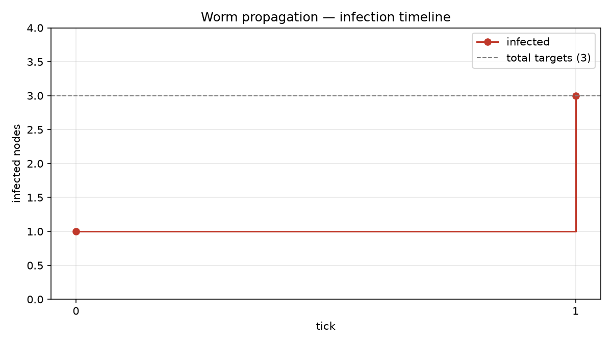
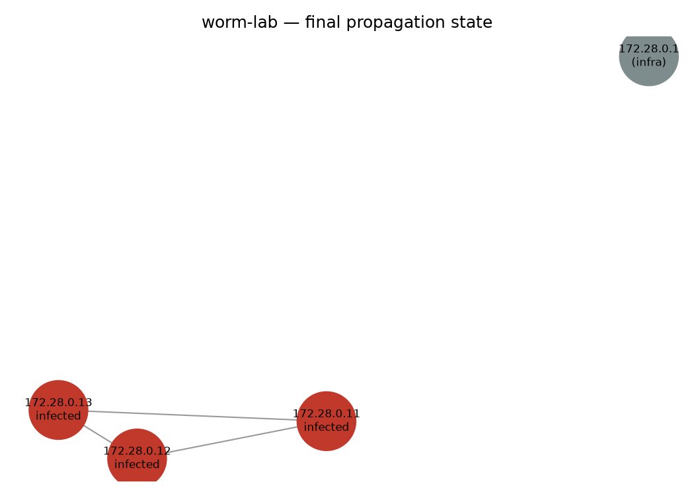

# Results

This page records the outcome of a completed run. Replace all example values with output actually produced by your implementation.

## Lab event

| Field | Value |
|---|---|
| Session ID | `REDACTED` |
| Transport | `https` |
| Host | `lab-target-1` |
| Remote address | `192.0.2.11` |
| Operating system | `linux/amd64` |

The event is stored as sanitized metadata in `logs/c2-events.jsonl`.

## Simulation

Example result format:

| Tick | New simulated infections | Cumulative simulated infections |
|---|---:|---:|
| 1 | 2 | 3 |
| 2 | 0 | 3 |

Example summary:

```json
{
  "ticks": 2,
  "infected": ["192.0.2.11", "192.0.2.12", "192.0.2.13"],
  "vulnerable": []
}
```

This is an illustrative example, not a claim that your run produced these values. Insert the exact output from your own test.

## Figures

Add generated figures after running the visualization scripts:

```markdown


```

## Interpretation

1. The result describes the assumptions in the simulation, not the probability of compromise in a real network.
2. The initial node is selected from a recorded lab event.
3. A fixed random seed allows the decision path to be compared across runs.
4. The model should be evaluated with different graph structures and parameter values before drawing broader conclusions.
